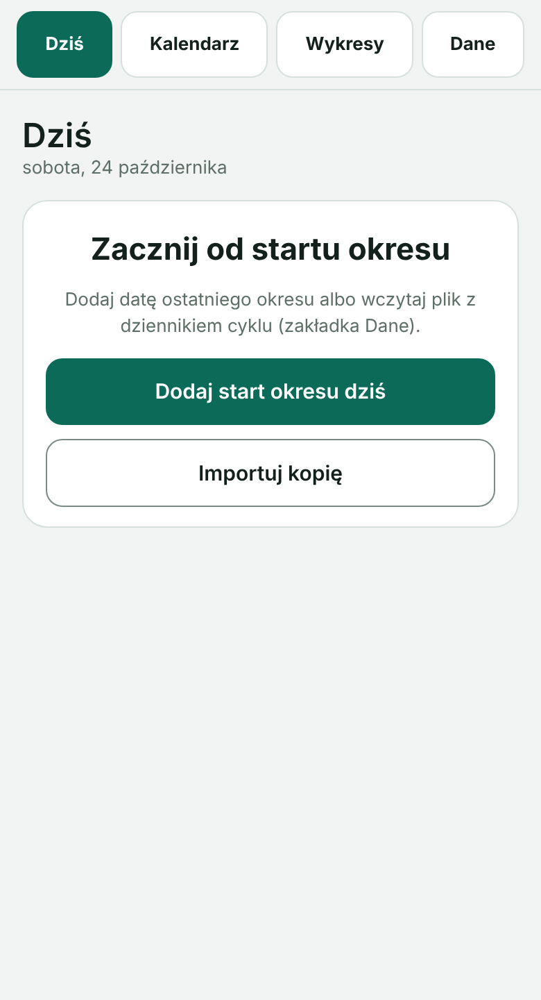
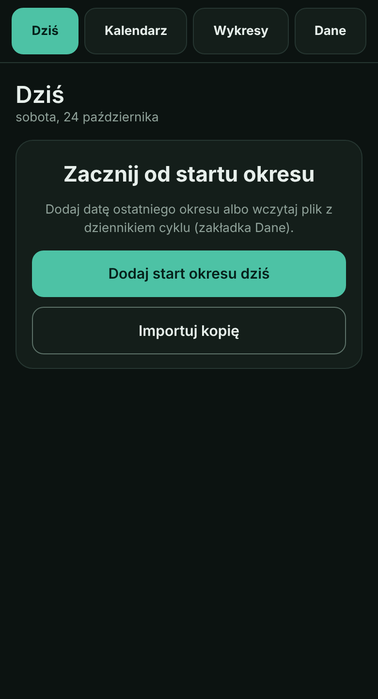

# Asystent leków

Wersja **0.14 (preview)**. Natywna aplikacja na Androida (Kotlin, Jetpack Compose), bez internetu, kont i analityki.

Dziennik **leków, ciśnienia, wyników badań, EKG z zegarka i (opcjonalnie) cyklu** dla jednej lub kilku osób. Dane zostają **tylko na telefonie**: w manifeście nie ma uprawnienia INTERNET (sprawdza to CI), a kopie zapasowe są plikami, które zapisujesz sam, najlepiej zaszyfrowanymi hasłem. Aplikacja zapisuje i porządkuje to, co wpiszesz, oznacza wartości poza zakresem i przygotowuje raport dla lekarza. **Nie stawia diagnoz, nie leczy i nie zastępuje lekarza.**

Aplikacja startuje **pusta**: nie ma w niej żadnych leków, danych ani imienia. Dodajesz je w Ustawieniach, wczytujesz z kopii zapasowej albo z plików przykładowych (patrz niżej).

## W skrócie

| Obszar | Do czego służy | Jak liczy / co oznacza |
|---|---|---|
| **Leki** | plan dnia z porami, odhaczanie z godziną, pominięcia z powodem, zapas, przypomnienia | zapas liczony z odhaczonych dawek i planu (ostrzeżenie przy ≤7 dniach), zgodność z planem w raporcie, przypomnienia alarmami (także po restarcie) |
| **Ciśnienie** | pomiary z tętnem i porą, wykres 7 dni – rok, średnie, historia | progi „podwyższone” 135/85 i „niskie” 90/60 (zmienisz w Ustawieniach); stałe ostrzeżenie od **180/110** i dla bardzo niskiego z wskazówką, kiedy dzwonić pod 112 |
| **Badania** | wyniki z zakresami odniesienia, wykresy, mapa, porównanie dni, skan zdjęcia lub PDF (OCR na telefonie) | flaga „poza zakresem” według zakresu z wyniku lub parametru; zmiana „istotna” od 10% zakresu, tendencja od 3 wyników; odczyt OCR zawsze do sprawdzenia |
| **EKG z zegarka** | odczyt wydruku PDF/obrazu (25 mm/s, 10 mm/mV), tętno, odstępy RR, trend | wykrywanie załamków R, tętno, RMSSD/SDNN/pNN50, wskazówki o nieregularności, przerwach i przedwczesnych uderzeniach; **bez oceny QT i ST**; zapis słabej jakości nie jest oceniany |
| **Raport** | PDF dla lekarza, tekst dla AI, „Przygotuj na wizytę” | sekcje do wyboru, ukryte moduły nie wchodzą do raportu; wpisy intymne tylko na życzenie |
| **Cykl** (opcjonalny) | dziennik cyklu, kalendarz, prognoza, wykresy, raport | okno płodne z prawdopodobieństwa (Wilcox 1995) i metody kalendarzowej od 6 cykli (najkrótszy − 18 do najdłuższy − 11); FIGO 2018 (24–38 dni, ≤8 dni krwawienia, regularność wg wieku), STRAW+10, pasma wieku do 50+ i tryby prognoz; **nie jest antykoncepcją** |
| **Kilka osób** | do 8 osób, osobne dane, wspólny motyw i blokada | kopia całości lub wybranych osób, dopisywanie z pliku, moduły do ukrycia per osoba |

**Prywatność i bezpieczeństwo:** blokada biometryczna (opcjonalna), kopie szyfrowane (PBKDF2-HMAC-SHA256 600 000 iteracji, AES-GCM), brak kopii do chmury Google, moduł Cykl w WebView bez sieci. Szczegóły: sekcja „Prywatność”.

## Zrzuty ekranów (puste ekrany)

Zrzuty pochodzą z automatycznych testów renderowania (wydanie [zrzuty-ekranow](https://github.com/Jack4B/leki/releases/tag/zrzuty-ekranow), odświeżane przy każdym buildzie) i pokazują aplikację bez żadnych danych.

<table>
<tr>
<td align="center"><br><sub>Leki</sub></td>
<td align="center"><br><sub>Ciśnienie</sub></td>
<td align="center"><br><sub>Badania</sub></td>
<td align="center"><br><sub>Raport</sub></td>
</tr>
<tr>
<td align="center"><br><sub>Ustawienia</sub></td>
<td align="center"><br><sub>Moduły aplikacji</sub></td>
<td align="center"><br><sub>Cykl (jasny)</sub></td>
<td align="center"><br><sub>Cykl (ciemny)</sub></td>
</tr>
</table>

## Dane przykładowe do wczytania

W katalogu [`przyklady/`](przyklady) są **zmyślone** pliki do wypróbowania aplikacji (osoby „Jan Przykładowy” i „Ola Przykładowa”, leki „Lek A/B/C”, dane z okresu 02–10.2026). Ściągnij plik na telefon i wczytaj go w Ustawienia → Kopie zapasowe i dane → **Wczytaj kopię z pliku** (okno zapyta, czy dopisać osoby, czy zastąpić dane; na pustej aplikacji wystarczy „Wczytaj kopię”). W raporcie wybierz okres obejmujący dane (np. „Wszystko”).

| Plik | Zawartość |
|---|---|
| `przyklad-jedna-osoba.json` | pełna kopia jednej osoby: 3 leki (w tym zmiana dawki i zapas), ok. 84 dni odhaczeń i pominięć, ~80 pomiarów ciśnienia (z jednym wysokim po wysiłku), wyniki badań w trzech terminach, kontrole |
| `przyklad-dwie-osoby.json` | dwie osoby: druga ma włączony moduł Cykl z dziennikiem (9 cykli), ukryte Ciśnienie, własne leki i wyniki |
| `przyklad-dziennik-cyklu.json` | sam dziennik cyklu do importu w module (Ustawienia → Moduł Cykl → Wczytaj plik z dziennikiem) |
| `przyklad-wyniki-badan.json` | plik wyników badań do dołączenia (Badania → import wyników) |

Pliki generuje test `SampleDataTest` (zmiana generatora wymaga odtworzenia plików: `WRITE_SAMPLES=1 ./gradlew :core:test --tests '*SampleDataTest*'`), więc zawsze zgadzają się z formatem kopii.

## Funkcje

- **Leki:** plan dnia z porami (śniadanie, obiad…), odhaczanie dawek z godziną, pomijanie dawek z powodem, zmiany dawkowania w czasie z zachowaniem historii, zamiana leku na inny, stoper po dawce, licznik wody, notatka dnia.
- **Ciśnienie:** pomiary z tętnem i porą, **przewijany wykres w czasie** (7, 30, 90 dni, rok lub wszystko), średnie, oznaczenia progów ustawianych przez użytkownika, historia podzielona na dni, tygodnie i miesiące (tak samo lista EKG). Szczegóły niżej.
- **Badania:** dziennik wyników z zakresami odniesienia (parametru albo własnym z danego badania), wykresy, przegląd z poprzednim wynikiem, zmianą i tendencją, **mapa wyników** (wszystkie dni badań w jednej tabeli), porównanie dni, widok według parametrów (grupami, alfabetycznie albo od ostatnio badanych, stan na wybrany dzień oraz **porównanie wyników z kilku dni** w tabeli) i dat (dzielony na dni, tygodnie i miesiące), kontrole z polem na wynik, import wyników z pliku JSON, **dodawanie wyników ze zdjęcia lub PDF (OCR)** oraz **analiza EKG z zegarka** (wydruk PDF).
- **Raport dla lekarza:** wybór okresu i sekcji, podgląd, druk lub zapis do PDF z menu Androida. Do raportu można dołączyć **odpowiedź AI** (wklejoną albo wczytaną z pliku Markdown) jako uzupełnienie.
- **Raport dla AI:** gotowy tekst (Markdown) z poleceniem i danymi z aplikacji, do wklejenia w dowolny model AI. Szczegóły niżej.
- **Przypomnienia o dawkach:** powiadomienia o porach z planu, także przy zamkniętej aplikacji i po restarcie telefonu.
- **Ręczne poprawianie odczytu OCR:** w edytorze leku rozpoznane wiersze wstawiasz dotknięciem do pola Nazwa, Substancja lub Wskazówka (wybranego przełącznikiem albo ostatnio dotkniętego), a „Zaznacz na zdjęciu” pozwala dotknąć napisu lub narysować prostokąt, który jest odczytywany jeszcze raz z powiększeniem. Przy wynikach badań ze zdjęcia, gdy odczyt nic nie znalazł, jest „Zaznacz tabelę na zdjęciu”. Zdjęcia (leki i wyniki) są czytane dwa razy (oryginał i wzmocniony kontrast), a lepszy wynik wygrywa.
- **Dodawanie leku ze zdjęcia opakowania** (Ustawienia → Leki → „Ze zdjęcia”): nazwa, moc, substancja czynna, jednostka i liczba sztuk w opakowaniu (od razu zapas) odczytywane na telefonie z tekstu na opakowaniu; wynik to propozycja w edytorze leku do sprawdzenia, a dawkowanie ustawiasz sam. Bez bazy leków i bez internetu, więc aplikacja niczego nie dopowiada.
- **Zapas leków:** w edycji leku wpisujesz, ile zostało w opakowaniu; aplikacja odlicza odhaczone dawki, pokazuje przy leku „zostało N, starczy na około M dni”, ostrzega bannerem i powiadomieniem, gdy zapasu starczy na kilka dni (próg w Ustawieniach → Przypomnienia, domyślnie 7). Stan zapasów widać na liście leków w Ustawienia → Leki (nazwa, stan i pasek: zielony, pomarańczowy poniżej progu ostrzeżenia, czerwony przy krytycznie małym zapasie; dotknięcie leku otwiera uzupełnianie), a ekran Leki ma odnośnik „Sprawdź zapasy leków” i ostrzeżenie, gdy coś się kończy. Liczba w edycji oznacza stan „teraz”: dawki odhaczone dziś są już w niej uwzględnione.
- **Przypomnienie o kopii zapasowej:** powiadomienie, gdy ostatnia kopia jest starsza niż 30 dni (próg do zmiany lub wyłączenia). Działa niezależnie od przypomnień o dawkach.
- **Blokada aplikacji:** odcisk palca, twarz albo blokada ekranu telefonu (system pyta o PIN, wzór lub hasło; aplikacja ich nie widzi). Ustawienia → Blokada aplikacji: włączenie wymaga potwierdzenia, można wybrać opóźnienie (zaraz, 30 s, 5 min) i opcjonalnie ukryć aplikację w ostatnich aplikacjach oraz zablokować zrzuty ekranu. Ustawienia blokady są tylko na tym telefonie i **nie trafiają do kopii zapasowej**.
- **Eksport CSV** do arkusza (Ustawienia → Kopie zapasowe i dane): ciśnienie, wyniki badań, dawki z ostatnich 90 dni, podsumowanie EKG. Format polski: separator średnik, przecinek dziesiętny, UTF-8 z BOM; tekst zaczynający się od `=`, `+`, `-`, `@` dostaje apostrof (ochrona przed wykonaniem jako formuły).
- **Szybsza obsługa:** przyciski **„Wzięte” i „Odłóż o 15 min” w powiadomieniu** o dawkach, **„Cofnij”** po usunięciu pojedynczej pozycji (pomiar, EKG, wynik, analiza, kontrola), **„Przygotuj na wizytę”** w raporcie, **udostępnianie odpowiedzi AI do aplikacji** („Udostępnij → Asystent leków”, „Otwórz w” dla .md) oraz **automatyczna kopia do wybranego folderu** (opcjonalnie szyfrowana hasłem).
- **Szybkie dodanie pomiaru ciśnienia:** skrót na ikonie aplikacji (przytrzymaj ikonę) oraz widżet na ekran główny; oba otwierają ekran dodawania pomiaru. Widżet pokazuje tylko, kiedy był ostatni pomiar (bez wartości, bo ekran główny widzą też inni).
- **Trend tętna z zapisów EKG** nad listą zapisów (od dwóch zapisów; zakres 30 dni, 90 dni, rok lub wszystko, przewijany w bok jak wykres ciśnienia) i **czerwone punkty na wykresie ciśnienia** dla pomiarów na progu podwyższonego ciśnienia lub powyżej.
- **Kopie zapasowe:** plik JSON albo plik zaszyfrowany hasłem (AES-256-GCM, PBKDF2), zapis do pliku lub przez systemowe „Udostępnij”.

Aplikacja tylko zapisuje i porządkuje dane wpisane przez użytkownika. Nie ocenia wyników i nie zastępuje lekarza. Dawkowanie zmieniaj zgodnie z jego zaleceniami.

## Raport dla AI

> **Odpowiedź AI w stałym formacie.** Polecenie zawiera sekcję „Format odpowiedzi”: ustalone nagłówki, tabele, ramki `> **Pilne:**`, `> **Do omówienia:**`, `> **Informacja:**` i znaczniki `[WYSOKIE]`/`[ŚREDNIE]`/`[NISKIE]`. Wklejona odpowiedź jest w raporcie dla lekarza stylowana (kolorowe ramki, plakietki, tabele, wyróżnione karty Podsumowania, Spraw pilnych i Pytań do lekarza). Szczegółowość (krótko lub szczegółowo) wybierasz w Raport → Dla AI. Gdy model nie trzyma się formatu, tekst wyświetla się po prostu zwykłym Markdownem.

W zakładce **Raport** jest sekcja **Raport dla AI**. Generuje ona jeden tekst w Markdown, który kopiujesz, udostępniasz jako plik `.md` albo wklejasz do wybranego modelu (ChatGPT, Claude, Gemini i inne).

Tekst składa się z dwóch części:

1. **Polecenie dla modelu:** analiza interakcji lek–lek, interakcji z jedzeniem i napojami, doboru pór dnia i odstępów między lekami, duplikatów substancji i nietypowych dawek, powiązań z wynikami badań i ciśnieniem, systematyczności przyjmowania oraz lista pytań do lekarza. Model ma podawać pewność wniosków, oddzielać sprawy pilne i nie zalecać samodzielnych zmian dawek.
2. **Dane:** leki z dawkowaniem i wskazówkami, harmonogram dnia (co jest brane razem), zmiany dawkowania, zgodność z planem (pominięte, spóźnione i nieodhaczone dawki, średnia godzina przyjęcia względem pory), ciśnienie, wyniki badań z zakresami, kontrole i notatki.

Do raportu można dołączyć zapisy EKG z zegarka z wybranego okresu (pigułka „EKG z zegarka”): wskaźniki, wyniki analizy i odstępy RR w milisekundach, bez surowego przebiegu, a polecenie dla modelu dostaje wtedy dodatkowy punkt o EKG z zakazem oceny QT i ST. Okres jest ten sam co w raporcie dla lekarza. Możesz wybrać sekcje i wpisać kontekst medyczny (wiek, płeć, choroby, alergie, leki bez recepty, godziny posiłków), co mocno poprawia analizę. Imię i nazwisko jest domyślnie pomijane. Tekst powstaje na urządzeniu i opuszcza je dopiero, gdy go skopiujesz lub udostępnisz. Odpowiedź AI nie jest poradą medyczną.

## EKG z zegarka

W zakładce **Badania → EKG** przycisk **Dodaj EKG z pliku PDF** wczytuje wydruk EKG wyeksportowany z aplikacji zegarka lub opaski (jedno odprowadzenie, zwykle 30 s w trzech pasach po 10 s).

1. Aplikacja renderuje stronę na telefonie i odtwarza przebieg z obrazu: czerwona linia na siatce, wydruk w standardzie 25 mm/s i 10 mm/mV, strona pionowa (pasy obrócone o 90°) lub pozioma.
2. Tekst nagłówka (OCR na urządzeniu) daje datę, godzinę, tętno i ocenę rytmu zegarka. Imię, płeć, wiek, wzrost i waga z wydruku **nie są odczytywane ani zapisywane**. Datę i resztę możesz poprawić przed zapisem.
3. Z przebiegu aplikacja liczy tętno, odstępy RR i ich zmienność, rozpoznaje zakłócenia ruchowe (są pomijane) i wskazuje kandydatów do omówienia z lekarzem: tętno poniżej 50 lub powyżej 100/min, wyraźnie nieregularny rytm, przedwczesne uderzenia z dłuższą przerwą po nich, długie przerwy.
4. Zapisy EKG można **usuwać prosto z listy** (przycisk „Usuń” przy zapisie; komunikat ma przycisk „Cofnij”). W podglądzie można przebieg **powiększać i przesuwać** (jeden palec przesuwa, dwa powiększają wokół punktu dotyku, przyciski „Całość, 10 s, 5 s, 2 s”, a **mapa zapisu** pod wykresem pokazuje okno i zdarzenia, a przeciągnięcie po niej przeskakuje w dane miejsce; gdy po ręcznym przesunięciu zaznaczone zdarzenie wypadnie poza widok, pojawia się przycisk „Wróć do zdarzenia”), z siatką jak na papierze. Położenie okna jest stanem (`EcgViewport` w `core`), więc dotknięcie nieprawidłowości zawsze ustawia ją na środku widoku. Zapis można **wyeksportować do PDF** (przycisk „Eksport PDF” w edytorze albo „PDF” przy zapisie w zakładce Raport): jedna strona A4 poziomo, przebieg w skali papieru (25 mm/s i 10 mm/mV, drukuj w 100%), wskaźniki, zdarzenia z czasem i opis metody; miejsca zdarzeń (przedwczesne uderzenia, przerwy, zakłócenia) są na przebiegu **numerowane**, z pomarańczowym pasem dla przedwczesnych uderzeń i przerw, a numery odpowiadają liście. Pod wykresem jest **lista nieprawidłowości** (przedwczesne uderzenia, przerwy, zakłócenia, wyniki dotyczące całego zapisu) z opisem; dotknięcie pozycji powiększa wykres i pokazuje to miejsce.
5. Zapis (przebieg w 250 próbkach na sekundę, zapisany wektorowo: ok. 4,5 KB na 30 s) jest w kopii zapasowej, a raport dla lekarza może zawierać sekcję „EKG z zegarka” z przebiegiem i wskaźnikami.

**Jak to jest liczone (algorytmy).** Obliczenia robi sama aplikacja na telefonie, bez bibliotek zewnętrznych, internetu i modeli AI (kod: `core/.../Ecg.kt`, opis w `EcgInfo.kt` i w aplikacji pod „Jak to jest liczone”):
1. **Odtworzenie przebiegu:** strona PDF jest renderowana do obrazu (300 dpi, a przy braku pamięci 200 dpi), piksele czerwonej linii zamieniane na przebieg (wiersz obrazu = chwila, odległość od mediany linii = napięcie), skala 25 mm/s i 10 mm/mV. Strona nie jest trzymana jako duża bitmapa: od razu powstaje z niej maska jednobajtowa (czwarta część pamięci), a bitmapa jest zwalniana; do odczytu nagłówka (OCR) służy osobny, mały render 200 dpi. Przebieg jest potem przeliczany do 250 próbek/s i zapisywany wektorowo (punkt 9).
2. **Dryf linii podstawowej** usuwany ruchomą medianą z okna 0,6 s.
3. **Uderzenia (QRS):** metoda energii pochodnej w duchu algorytmu Pana i Tompkinsa (1985), uproszczona: kwadrat różnicy próbek wygładzony oknem 60 ms, próg 25% mediany maksimów z okien 1,5 s, odstęp refrakcji 250 ms, punkt R jako maksimum w ±70 ms, kierunek QRS według większości uderzeń.
4. **Zakłócenia:** pomijane fragmenty ±0,35 s wokół wychyleń ponad 2,5 amplitudy R, wychyleń przeciwnych do QRS o amplitudzie co najmniej 0,9 R i skoków o energii pochodnej ponad 4 razy większej niż QRS. Wychylenie tego samego kierunku co QRS z zespołem o stromości zwykłego QRS w pobliżu (±0,10 s; od połowy do 4 razy typowej energii, amplituda co najmniej 0,5 mV) to nie zakłócenie, tylko duże lub szerokie uderzenie (np. komorowe) i zostaje do oceny. Skoki w przeciwną stronę zostają zakłóceniem.
5. **Wskaźniki:** tętno = 60 / RR (mediana, średnia, zakres), SDNN, RMSSD, pNN50 (różnice kolejnych odstępów większe niż 50 ms).
6. **Wzorzec losowej nieregularności (z samych odstępów RR):** RMSSD/średni RR co najmniej 0,12, odsetek punktów zwrotnych w ciągu od 55% do 82% (losowy ciąg ma ok. 67%, gładka zmienność oddechowa mniej, bigeminia 100%) i entropia próbkowa (m = 1, r = 0,2 SD) co najmniej 1,0; wszystkie trzy naraz i co najmniej 20 odstępów dają oznaczenie „odstępy jak przy migotaniu przedsionków”. Progi dobrano na sygnałach syntetycznych, bez walidacji na prawdziwych zapisach z migotaniem.
7. **Kształt uderzeń i szerokość QRS:** szablon to mediana czystych uderzeń; korelacja z szablonem ocenia jakość; szerokość QRS mierzona na stromych zboczach (próg 15% maksymalnego nachylenia, rozdzielczość jednej próbki, 4 ms przy 250 Hz) służy do porównań. Przedwczesne uderzenie dostaje opis „kształt odmienny (możliwe komorowe)” (korelacja poniżej 0,75 albo QRS o ponad 30% szerszy) albo „zbliżony (możliwe przedsionkowe lub nadkomorowe)”.
8. **Reguły oznaczeń:** wolne tętno (mediana poniżej 50/min), szybkie (powyżej 100/min), rytm wyraźnie nieregularny (co najmniej 35% odstępów odbiega o ponad 15% od mediany i współczynnik zmienności powyżej 0,1), przedwczesne uderzenie (odstęp poniżej 80% mediany, po nim powyżej 110%), przerwa (odstęp powyżej 1,6 mediany i powyżej 1,8 s; odstępy 3–10 s też są przerwami, ale nie wchodzą do SDNN i RMSSD, które liczą odstępy 0,25–3,0 s). Zapis słabej jakości (zakłócenia w ponad 35% czasu albo korelacja kształtu poniżej 0,6) dostaje oznaczenie „Zapis słabej jakości” zamiast „Rytm regularny”. Do oceny potrzeba co najmniej 8 uderzeń.

9. **Zapis wektorowy (mały rozmiar bez utraty wierności):** zamiast równych próbek zapisywane są tylko punkty załamania linii (uproszczenie Ramera, Douglasa i Peuckera z błędem pionowym do 0,02 mV, czyli ok. 2 piksele wydruku w 300 dpi), jako różnice indeksów i wartości w zmiennej długości, base64. Odtworzenie przez interpolację liniową różni się od przebiegu o najwyżej 0,02 mV, a szczyty R zostają zachowane (są wierzchołkami). Przebieg w pamięci jest sprowadzany do punktu stałego zapisu, więc wielokrotne zapisywanie nie powoduje dryfu. Na zmierzonym wydruku (30 s): równe próbki 250 Hz w poprzednim zapisie ok. 9,9 KB, zapis wektorowy ok. 4,5 KB (1657 punktów z 7410), pierwotna lista liczb ok. 93 KB.

To zwykła heurystyka, a nie zatwierdzony algorytm medyczny; nie była walidowana klinicznie.

**Wierność odtworzenia przebiegu.** Zmierzono ją na jednym wydruku z zegarka, porównując odtworzenie z obrazu strony z natywnymi obrazami pasów zapisanymi w PDF (454 ppi, czyli jeden piksel to ok. 2,2 ms i 0,006 mV). Wzorzec nie jest „prawdą” o sercu, tylko najlepszą dostępną kopią tego, co narysował zegarek:

| Rozdzielczość renderowania | Błąd średniokwadratowy | R (amplituda) | Tętno z odtworzenia |
|---|---|---|---|
| 200 dpi (do wersji 0.6.3) | 0,12 mV | o ok. 2–3% większa | różnica poniżej 0,3/min |
| 300 dpi (obecnie w aplikacji) | 0,05 mV | o ok. 2–3% większa | różnica poniżej 0,3/min |
| 400 dpi | 0,03–0,04 mV | o ok. 2–3% większa | różnica poniżej 0,3/min |

Zapis wektorowy (punkt 9) nie pogarsza tego istotnie: błąd średniokwadratowy względem wzorca wynosi 0,050 mV tak samo jak dla równych próbek (0,049 mV), bo o błędzie decyduje rastrowa kopia linii w PDF, a nie sposób zapisu. Największe odchylenia (do ok. 1–2 mV) są w miejscach zakłóceń ruchowych, gdzie linia na wydruku ma strome skoki. Zawyżenie amplitudy R o 2–3% wynika z grubości linii na obrazie. Tętno, liczba uderzeń i odstępy RR zgadzają się z wzorcem, co jest najważniejsze dla analizy rytmu; **drobne szczegóły kształtu (np. początek i koniec załamków) nie są odwzorowane dokładnie** i nie nadają się do pomiarów.

**Ograniczenia, które trzeba znać:**
- To narzędzie pomocnicze do rozmowy z lekarzem, a nie diagnoza ani wyrób medyczny. Brak oznaczeń nie wyklucza choroby serca.
- Aplikacja **nie mierzy odstępu QT ani odcinka ST** i nie rozpoznaje niedokrwienia ani zawału. Zegarek daje jedno odprowadzenie, które do tego się nie nadaje. Przy lekach wydłużających QT albo zaburzeniach potasu potrzebne jest pełne EKG z gabinetu.
- Skala czasu i napięcia wynika z faktycznej rozdzielczości obrazu strony (jedna skala dla obu osi, także dla A4 poziomo w 300 dpi). Gdy tętno z przebiegu różni się od tętna z zegarka o ponad 15%, edytor ostrzega o możliwym błędzie odczytu. Uderzenia o amplitudzie poniżej 35% typowej są pomijane (tętno może wyjść zaniżone). Wykres w raporcie pokazuje pierwsze 30 s zapisu, analiza obejmuje całość.
- Odtworzenie z obrazu jest przybliżone (rozdzielczość czasowa około 5 ms). Przed zaufaniem analizie porównaj przebieg na ekranie z wydrukiem.
- Algorytm sprawdzono na jednym prawdziwym wydruku z zegarka i na sygnałach syntetycznych. Inne marki i formaty wydruków mogą nie działać (aplikacja zgłosi, że nie znalazła przebiegu). Nie ma walidacji klinicznej.
- Przy bólu w klatce piersiowej, duszności, omdleniu lub kołataniu serca nie czekaj na analizę: skontaktuj się z lekarzem lub zadzwoń pod 112.

## Długie listy: dni, tygodnie, miesiące

Lista **Zapisane pomiary** (Ciśnienie), lista zapisów **EKG** (Badania → EKG), widok **Daty** w Badaniach oraz historia jednego parametru (powyżej 12 wyników) nie rosną w nieskończoność. Przełącznik nad listą ma trzy widoki:

- **Lata:** karty lat (zwinięte), przydatne przy wieloletniej historii.
- **Dni:** ostatnie 7 dni rozwinięte dzień po dniu, starsze pozycje w zwiniętych kartach tygodniowych.
- **Tygodnie** (od poniedziałku): same karty tygodni, najnowszy rozwinięty.
- **Miesiące:** same karty miesięcy, wszystkie zwinięte.

Karta okresu pokazuje podsumowanie (liczba pozycji, średnie ciśnienie i tętno albo zakres tętna z EKG, liczba pozycji do uwagi); dotknięcie rozwija ją i pokazuje pozycje pogrupowane dniami, z przyciskiem „Usuń”. Przycisk **Tylko podwyższone** (ciśnienie), **Tylko z oznaczeniami** (EKG) albo **Tylko poza zakresem** (badania) zostawia na liście pozycje na progu lub powyżej, albo z oznaczeniami do omówienia z lekarzem. Lista pokazuje wszystkie pomiary niezależnie od zakresu wykresu. Logika grupowania i podsumowań jest w `core/.../History.kt`.

## Badania w czasie: przegląd, mapa, porównanie

Badania mają cztery widoki: **Przegląd | Mapa | Daty | EKG**. Zostały zaprojektowane tak, żeby po latach badań łatwo było zobaczyć, co się zmieniło; część elementów pojawia się dopiero wtedy, gdy jest dość danych.

- **Przegląd:** parametry z ostatnim wynikiem, **poprzednim wynikiem**, zmianą (liczba i procent) oraz **tendencją** (od trzech wyników: „rośnie od 4 badań”, „maleje od 3 badań”, „stabilnie”, „bez wyraźnej tendencji”). Zmiana jest istotna (pogrubiona), gdy wynosi co najmniej 10% zakresu odniesienia (bez zakresu: 10% poprzedniej wartości); tendencja liczy kolejne kroki większe niż 4% zakresu w tę samą stronę. To opis liczb, nie ocena zdrowotna. Sortowanie: Grupami (w grupie alfabetycznie), A–Z, Najnowsze. Filtry: Poza zakresem, Zmienione od poprzedniego, Przypięte. Lista **„Wyniki z dnia”** pokazuje stan na wybrany dzień (ostatni wynik z tego dnia lub wcześniejszy), a „Tylko wyniki z tego dnia” tylko parametry zbadane wtedy. Gdy badania obejmują ponad rok, miniwykresy mają okno: Rok, 3 lata, Wszystko.
- **Mapa:** parametry w wierszach, dni badań w kolumnach (od najstarszego, przewijane w bok); kolor pola to ocena względem zakresu. Dotknięcie otwiera historię parametru.
- **Porównaj dni** (w Przeglądzie): skróty „Ostatnie i poprzednie”, „Ostatnie i sprzed roku”, „Ostatnie 4” albo do 4 wybranych dni; tabela ze zmianą pod nazwą parametru i filtrem „Tylko zmienione”.
- **Parametr (szczegóły):** wykres z oknem Rok | 3 lata | Wszystko, „Nałóż rok temu” (ten sam okres z poprzedniego roku jaśniejszą linią), zdanie o tendencji i o wyniku sprzed roku, przypinanie (★/☆), historia (do 12 wyników lista, dłuższa dzielona na dni, tygodnie, miesiące i lata).
- **Zakres odniesienia przy wyniku:** laboratoria i wiek zmieniają normy, dlatego wynik może mieć własny zakres (edycja wyniku → „Zakres z tego badania”; skan zapisuje go, gdy różni się od zakresu parametru). Taki wynik jest oceniany według własnego zakresu, pozostałe według zakresu parametru.
- **Daty:** wyniki według dni badań, dzielone na dni, tygodnie, miesiące i lata; w widoku „Dni” rozwinięte jest ostatnie 90 dni.

## Wykres ciśnienia w czasie

Wykres ma stałą skalę czasu, więc przy długim okresie nie zlewa się w kreskę, tylko robi się szerszy i przewija się palcem w bok (oś ciśnienia zostaje po lewej, a wykres otwiera się na najnowszych dniach). Zakres wybierasz przyciskami **7 dni, 30 dni, 90 dni, Rok, Wszystko**.

- **Do 45 dni:** każdy pomiar jest punktem, z podpisem dni. Przerywane linie to progi podwyższonego ciśnienia ustawione w aplikacji.
- **Powyżej 45 dni:** dla każdego dnia pionowy słupek od najniższego do najwyższego pomiaru i linia średnich dziennych. Podpisy to tygodnie (do ok. 4 miesięcy) albo początki miesięcy (rok i dłużej).
- **W raporcie do druku** wykres jest cięty na kawałki po 91 dni, a pod nim jest zestawienie tygodniowe (powyżej ok. 6 miesięcy: miesięczne) ze średnimi, zakresami, tętnem i liczbą pomiarów podwyższonych i niskich. Pełna lista każdego pomiaru jest tylko w raportach do 45 dni, żeby roczny wydruk miał kilka stron, a nie kilkadziesiąt.

## Kilka osób w jednej aplikacji

Pod nazwą aplikacji w nagłówku jest wybór osoby (kółko z inicjałem i imię). Dotknięcie pokazuje listę osób, „Dodaj osobę” i „Zarządzaj osobami” (Ustawienia → Osoby). Każda osoba ma **osobne** leki, odhaczenia, ciśnienie, badania, EKG, analizy AI, ustawienia raportów, kontrole i dziennik cyklu, więc raporty (dla lekarza i dla AI), badania i wszystkie wykresy zawsze dotyczą wybranej osoby. Wspólne są tylko wygląd (motyw), blokada aplikacji i ustawienia automatycznej kopii. Do 8 osób.

- **Kopie zapasowe** (zwykła, zaszyfrowana hasłem, „Kopiuj JSON”, automatyczna do folderu) domyślnie zawierają wszystkie osoby. W Ustawienia → Kopie zapasowe i dane można wybrać **tylko niektóre osoby** (np. żeby przenieść dane jednej osoby na jej telefon); wtedy wspólny dziennik cyklu jest dołączany do osoby, która z niego korzysta. Automatyczna kopia do folderu zawsze obejmuje wszystkich.
- **Wczytywanie kopii na innym telefonie:** zainstaluj aplikację, wybierz Ustawienia → Kopie zapasowe i dane → „Wczytaj kopię z pliku” (pasuje do kopii wszystkich albo wybranych osób, także zaszyfrowanej). Na świeżej aplikacji jest jedno „Wczytaj kopię”. Gdy w aplikacji już ktoś jest, okno wylicza osoby z pliku i daje wybór: **„Dodaj osoby z pliku”** (niczego nie usuwa; powtórzone imię dostaje dopisek „(z pliku)”, limit 8 osób, po dodaniu otwiera się dodana osoba, a jej przypomnienia o lekach działają od razu na tym telefonie) albo **„Zastąp wszystkie dane”** (usuwa osoby z telefonu; można to od razu wycofać przyciskiem „Cofnij”, po cofnięciu aktywna jest pierwsza osoba). Starsza wersja aplikacji wczyta z kopii pierwszą osobę. **Uwaga:** „Zapisz JSON” i „Kopiuj JSON” nie szyfrują danych. Plik, który wysyłasz komuś albo do chmury, rób jako zaszyfrowaną kopię, a hasło przekaż osobno. Nazwy plików nie zawierają imion (JSON: `leki-kopia-RRRR-MM-DD[-wybrane].json`).
- **Przypomnienia** działają dla wszystkich osób; przy więcej niż jednej osobie tytuł powiadomienia zaczyna się od imienia.
- **Wspólny dziennik cyklu:** Ustawienia → Moduł Cykl → „Czyj dziennik”: osoby mogą współdzielić jeden dziennik (wpisy zmieniane przez jedną są widoczne u drugiej). Dane są zapisane u osoby-właściciela; raporty i „Podsumowanie cyklu” korzystają z dziennika wspólnego. Działa w jednej aplikacji na jednym telefonie; między dwoma telefonami nie ma synchronizacji (aplikacja nie ma sieci), można przenosić plik dziennika lub kopię zapasową.
- **Przeniesienie dziennika cyklu:** Ustawienia → Osoby → „Przenieś do: …” (gdy wybrana osoba ma dziennik, a inna go nie ma).
- **Widżet ciśnienia** pokazuje ostatni pomiar wybranej w tej chwili osoby. **Powrót do starszej wersji aplikacji** (sprzed obsługi osób) pokazuje tylko pierwszą osobę (plik `state.json`); dane pozostałych osób zostają w plikach i wracają po ponownej aktualizacji.
- **Pamięć:** dane każdej osoby w osobnym pliku w pamięci aplikacji (`state.json` dla pierwszej, `state-p2.json`… dla kolejnych, lista w `profiles.json`); przy pierwszym uruchomieniu powstaje zapas `state.przed-osobami.json`. Uszkodzony plik osoby jest odkładany obok jako `*.uszkodzony.json`, osoba startuje pusta, a jej pustego stanu nie zapisują zmiany automatyczne; automatyczna kopia zapasowa czeka na decyzję (wczytanie kopii albo „Zaczynam od nowa” na ekranie Leki). Wczytanie kopii zapisuje najpierw nowe pliki i listę osób, a stare pliki osób kasuje dopiero na końcu (zapas `state.przed-osobami.json` zostaje do usunięcia pierwszej osoby albo „Usuń wszystkie dane”). Logika magazynu osób (odczyt z odtwarzaniem, wczytanie kopii, dopisywanie osób) jest w `core` (`Profiles`) z testami.
- **Prywatność:** dane zdrowotne (także osób trzecich) nigdy nie trafiają do repozytorium; do GitHuba idzie tylko kod i zmyślone dane testowe. Kopie zapasowe szyfruj hasłem.

## Moduł „Cykl” (opcjonalny)

Ustawienia → **Moduł Cykl** → Widoczny pokazuje zakładkę **Cykl** na dolnym pasku (domyślnie moduł jest ukryty; ukrycie nie kasuje danych). To dziennik cyklu: szybkie zapisy dnia, kalendarz, prognoza następnego okresu i okna płodnego (statystyczna, nie jest antykoncepcją ani diagnozą), wykresy długości cykli, raport tekstowy dla lekarza lub AI.

- **Jak jest zrobiony:** gotowa strona HTML bez zależności (`cykl/`, ze źródłami, testami i opisem) otwierana w WebView bez dostępu do sieci. Plik wchodzący do APK to `app/src/main/assets/cykl/cykl.html` (wynik `npm run build` w `cykl/`; CI sprawdza zgodność ze źródłami). Dołożone są `host.js` (most do aplikacji) i `host.css` (wygląd aplikacji).
- **Dane:** baza (`entries`, `cycles`, `settings`) jest w pamięci aplikacji i **wchodzi do kopii zapasowej** (sekcja `cykl`), także zaszyfrowanej i automatycznej. Raport CSV **nie zawiera** danych cyklu, a raporty dla lekarza i AI tylko opcjonalne „Podsumowanie cyklu” (domyślnie wyłączone, bez wpisów intymnych). Dane zdrowotne nie opuszczają telefonu.
- **Import z pliku:** najpewniej w Ustawienia → Moduł Cykl → **Wczytaj plik z dziennikiem (JSON)** (systemowy wybór pliku, wybór Połącz / Zastąp, Cofnij); to samo można w module (Dane → Import): wybór pliku JSON (np. kopia z poprzedniej aplikacji do cyklu o tym samym formacie) albo wklejenie; potem „Połącz” (dodaje nowe wpisy) lub „Zastąp wszystko” (poprzednia wersja zostaje jako zapas). Plik przykładowy z zmyślonymi danymi: `core/src/test/resources/fixtures/cykl-przyklad.json`.
- **Eksport całej bazy:** Ustawienia → Moduł Cykl → **Zapisz całą bazę do pliku (JSON)** albo w module Dane → Pobierz kopię (JSON); system pyta, gdzie zapisać plik. Kopia całej aplikacji z lekami i cyklem: Ustawienia → Kopie zapasowe i dane.
- **Wpisy intymne:** „Stosunek”, „Zabezpieczone” i „Solo — partner/ka” są tylko w dzienniku i w kopii zapasowej. Wpisy solo nigdy nie trafiają do raportów (ani do raportu w module, ani do raportu dla lekarza czy AI w aplikacji); raport tekstowy w module zawiera informacje o stosunkach (liczbę i daty) **tylko po zaznaczeniu** „Dołącz informacje o stosunkach” (domyślnie wyłączone). Nie trzeba osobnej osoby do takich zapisów: prowadzi się je w dzienniku danej osoby.
- **Raport dla lekarza z wykresami cyklu:** opcja „Podsumowanie cyklu” w Raporcie dodaje sekcję z tabelą ostatnich 12 cykli i trzema wykresami do druku (długość cyklu na tle zakresu 24–38 dni, czas krwawienia, zmiana względem poprzedniego cyklu); skrót w Ustawieniach → Moduł Cykl. Zakresy odniesienia są tylko oznaczeniem, bez rozpoznania.
- **W raportach:** opcjonalne „Podsumowanie cyklu” (raport dla lekarza i dla AI, domyślnie wyłączone): długości cykli, mediana, rozrzut, ostatni początek okresu, choroby i leki wpisane w module. Wpisy intymne nie wchodzą do raportów.
- **Okno płodne w kalendarzu:** okno płodne to ok. 6 dni kończących się w dniu owulacji (plemniki żyją do 5 dni, komórka jajowa ok. doby; Wilcox i wsp., NEJM 1995, BMJ 2000; Dunson i wsp. 2002). Kolor dnia: **wysokie ryzyko (szczyt okna)** = co najmniej 50% prawdopodobieństwa, że dzień jest w oknie; **okno płodne (możliwe)** = 20–50% albo dzień z zakresu **metody kalendarzowej**; reszta „okno mało prawdopodobne” (poczęcie nigdy nie jest wykluczone). Metoda kalendarzowa (od 6 zapisanych cykli, jak w wytycznych: najkrótszy cykl − 18 do najdłuższy − 11, np. Mayo Clinic, Family Planning Handbook; przy cyklach 26–32 dni dni 8–19 metody dni standardowych) liczy się od ostatniego startu okresu i oznacza dni jako co najmniej „możliwe”: **przy nieregularnych cyklach obejmuje większość cyklu, bo wytyczne nie pozwalają wtedy wskazać bezpiecznych dni** (w jednym z badań tylko ok. 30% kobiet miało okno w „typowych” dniach 10–17). Wysokość słupka w pasku 21 dni to względna szansa poczęcia przy stosunku w danym dniu. Bez historii (mniej niż 3 cykle) i bez testu LH szczyt okna nie jest pokazywany jako „wysokie ryzyko”. W okołomenopauzie (46+) owulacja i ciąża nadal są możliwe, a metody oparte na kalendarzu są wg wytycznych (CDC US MEC) „z ostrożnością”: prognoza jest wtedy mniej pewna, a progu ryzyka nie obniżamy. Prognoza nie jest antykoncepcją.
- **Moduły aplikacji (Ustawienia → Moduły aplikacji):** każda osoba może ukryć zakładki Ciśnienie, Badania i Cykl (Leki i Raport są zawsze). Ukrycie niczego nie kasuje, a ukryty moduł nie wchodzi do raportów dla lekarza i AI (także podsumowanie Cyklu), a eksport CSV ukrytego modułu jest tylko, gdy są w nim dane; widżet pokazuje wtedy „Moduł ukryty w Ustawieniach”.
- **Szczegóły dnia** (dotknięcie dnia w kalendarzu, „Więcej…”) otwierają się jako osobna strona z paskiem „‹ Wróć / Zapisz” u góry, a nie arkusz przypięty do dołu (na telefonie widać było tylko wąski pasek).
- **Wiek i tryb prognoz (Wykresy → Wiek; Dane → Tryb prognoz):** pasma 18–25, 26–41, 42–45, **46–50** i **powyżej 50 lat**. Do 45. roku życia obowiązują progi FIGO 2018 (regularność ≤7 dni w wieku 26–41, ≤9 dni w 18–25 i 42–45). **Po 45. roku życia regularność nie jest oceniana**, bo duża zmienność cykli jest wtedy częsta (okołomenopauza); rozkłady długości cyklu i fazy lutealnej są szersze, a pewność prognozy ograniczona (46–50: najwyżej średnia, po 50.: niska). Wskazówka STRAW+10 (wczesna faza przejściowa: powtarzająca się różnica ≥7 dni między cyklami; późna: przerwa ≥60 dni; menopauza: brak miesiączki ponad 12 miesięcy) pojawia się jako kryterium dla osób od 42 lat, u młodszych jako neutralny opis częstych przyczyn (PCOS, tarczyca, stres, masa ciała, leki). **Krwawienie po ponad 12 miesiącach bez miesiączki** zawsze trafia do listy „do gabinetu”. Tryby: „Antykoncepcja hormonalna” wyłącza prognozy płodności i wskazówkę STRAW (okresy są nadal prognozowane), „Ciąża, połóg lub karmienie” wyłącza wszystkie prognozy i flagi braku miesiączki. W wieku 46+ ekran Dziś przypomina, że poczęcie jest nadal możliwe i że antykoncepcję zwykle zaleca się do 12 miesięcy bez miesiączki po 50. roku życia (do 24 miesięcy przed 50.): do omówienia z lekarzem.
- **Algorytmy po przeglądzie medycznym:** poziomy w kalendarzu wynikają z prawdopodobieństwa, że dzień należy do okna płodnego i z metody kalendarzowej (patrz „Okno płodne” wyżej); „pewność wysoka” dopiero od 6 cykli; „Okres się spóźnia” liczone od końca własnego 80% zakresu cykli (nie od mediany), a przy teście LH od prognozy opartej na owulacji; gdy historia nie ma tak długich cykli, jest „Brak prognozy” zamiast sztucznej prognozy; test LH liczy się, jeśli nie wypada w trakcie miesiączki i tuż po niej ani w ostatnich 9 dniach cyklu (przy kilku seriach: ostatnia seria). FIGO: pojedynczy cykl poza 24–38 dni nie jest flagą (dopiero 2 z ostatnich 6 albo mediana poza zakresem), regularność oceniana od 6 cykli, dane z ostatnich 12 miesięcy, plamienia poza okresem dopiero gdy powtarzają się w różnych cyklach, obfite krwawienie to obfitość 4–5 przez co najmniej 2 dni albo skrzepy w co najmniej 2 miesiączkach, dodatni test ciążowy liczy się 100 dni, zaprzeczenie „brak anemii” nie jest anemią. Trend (wydłużanie/skracanie) pokazywany dopiero od 6 cykli i po teście Manna–Kendalla. Wszystkie ekrany przypominają, że prognoza nie jest antykoncepcją ani dowodem ciąży lub jej braku.
- **Nowe cykle poniżej 15 dni** (podwójny wpis startu) są scalane z pierwszym, jak w raporcie z aplikacji.
- **Wyłączenie:** Ustawienia → Moduł Cykl → Ukryty (dane zostają) albo „Usuń dane modułu Cykl”.
- **Zmiany w module:** edytuj `cykl/src`, uruchom `npm test` (Node ≥ 22.18), skopiuj `cykl/dist/cykl.html` do `app/src/main/assets/cykl/cykl.html`.

## Automatyczna kopia do folderu

Ustawienia → Kopie zapasowe i dane → **Automatyczna kopia do folderu**. Wybierasz folder przez systemowe okno (aplikacja nie dostaje uprawnień do całej pamięci, a nadal nie ma uprawnienia INTERNET). Po zmianie danych, gdy minął wybrany odstęp (codziennie albo co tydzień), w tle powstaje plik `asystent-lekow-kopia-RRRR-MM-DD.json` (z szyfrowaniem: `….zaszyfrowana.json`); zostaje 7 ostatnich. Zalecane jest szyfrowanie hasłem: w folderze synchronizowanym z chmurą leżą dane zdrowotne. Hasło jest przechowywane na telefonie zaszyfrowane kluczem z Android Keystore (poza kopią i plikiem); jeśli je zgubisz, plik nie otworzy się nigdzie. Plik wczytujesz tak jak każdą inną kopię (Wczytaj kopię z pliku). Ustawienia tej funkcji są tylko na tym telefonie i nie trafiają do kopii. Gdy zapis się nie powiedzie (np. folder usunięty, brak miejsca), ekran pokazuje komunikat, a przycisk „Zrób teraz” próbuje jeszcze raz.

## Analiza AI jako uzupełnienie raportu dla lekarza

Odpowiedź modelu AI na „Raport dla AI” (patrz wyżej) możesz wkleić do aplikacji i dołączyć do raportu dla lekarza.

0. Najkrócej: w aplikacji AI wybierz **Udostępnij → Asystent leków** (albo otwórz zapisany plik `.md` przez „Otwórz w”), a edytor analizy otworzy się z gotowym tekstem.
1. W zakładce **Raport → Dla lekarza** włącz pigułkę **Analiza AI** i wybierz **Wklej odpowiedź AI** (albo link pod raportem w karcie „Dla AI”). Przycisk **Wklej ze schowka** wstawia tekst, a **Wczytaj z pliku** wczytuje odpowiedź zapisaną jako plik **Markdown (.md)** albo tekstowy (.txt), do 1 MB. Aplikacja rozpoznaje kodowanie (UTF-8 z BOM lub bez, UTF-16, a w razie potrzeby Windows-1250 ze starszych edytorów), ujednolica znaki końca linii i podpowiada tytuł (pierwszy nagłówek `# …` albo nazwa pliku). Pliki binarne i kopie zapasowe są odrzucane z wyjaśnieniem, a gdy w polu jest już tekst, aplikacja pyta, czy go zastąpić. Tekst można też wpisać lub poprawić ręcznie.
2. Wzory LaTeX i Markdown (nagłówki, listy, tabele, pogrubienia, cytaty) są w raporcie porządkowane do zwykłego tekstu, np. `$2{,}8\text{ mmol/l}$` wychodzi jako „2,8 mmol/l”.
3. **Skracanie:** tekst jest dzielony na sekcje według nagłówków; każdą można wyłączyć. Przy długim tekście aplikacja od razu zostawia tylko sekcje o podsumowaniu, sprawach pilnych, wnioskach, zaleceniach i pytaniach do lekarza. Przyciski „Tylko podsumowanie i pytania” oraz „Całość” przełączają to jednym ruchem.
4. W raporcie analiza jest na końcu, z nagłówkiem „Uzupełnienie: analiza farmaceutyczno-kliniczna (AI)” i adnotacją, że to tekst wygenerowany przez AI na podstawie danych z aplikacji, a nie ocena lekarska.
5. Analizy zapisują się **w kopii zapasowej** (także zaszyfrowanej) razem z pozostałymi danymi. Można mieć kilka (np. z różnych dat) i wybierać, która trafia do raportu. Starsze kopie bez analiz wczytują się normalnie.

## Dodawanie wyników ze zdjęcia lub PDF

W zakładce **Badania** przycisk **Skanuj wyniki** otwiera wybór źródła: **aparat**, **galeria** (jedno lub kilka zdjęć albo zrzutów ekranu) albo **plik PDF** (także skany w PDF, do 12 stron).

1. Aplikacja rozpoznaje tekst na telefonie (ML Kit, model dołączony do aplikacji). Zdjęcia i pliki są przetwarzane w pamięci, nie są zapisywane ani nigdzie wysyłane, a aplikacja nie ma uprawnienia INTERNET.
2. Z położenia tekstu składa wiersze tabeli i odczytuje nazwę badania, wynik, jednostkę i zakres odniesienia. Obsługuje układ tabeli, listy („Potas: 4,2 mmol/l (3,5 - 5,1)”) i „nazwa nad wynikiem”. Rozpoznaje datę pobrania (pomija datę urodzenia) i dopasowuje parametry do tych z aplikacji: zna polskie nazwy i skróty (np. Potas, K, Sód, Na, HGB, WBC, TSH, CRP, cholesterol HDL i LDL), a nieznane proponuje jako nowe parametry razem z zakresem z dokumentu. Gdy OCR przekręci nazwę, parametr jest zgadywany po jednostce i zakresie odniesienia i oznaczany do sprawdzenia.
3. **Ekran sprawdzania** pokazuje każdy wynik z oryginalnym wierszem. Możesz poprawić wartość, zmienić parametr, odznaczyć wiersz i ustawić datę. Aplikacja ostrzega, gdy jednostka różni się od zapisanej w aplikacji (np. mg/dl zamiast mmol/l: taki wynik jest domyślnie odznaczony), gdy wynik z tego dnia już istnieje, gdy zmiana względem poprzedniego wyniku jest podejrzanie duża (pomyłka w przecinku) i gdy w wyniku jest „<” lub „>”.
4. Dopiero po kliknięciu **Zapisz** wyniki trafiają do dziennika (z dopiskiem „ze skanu”). Istniejący wynik z tego samego dnia jest zastępowany.

Wskazówki: cała tabela w kadrze, tekst poziomo, bez cienia i odblasków. PDF pobrany z laboratorium daje zwykle lepszy rezultat niż zdjęcie. Na ekranie sprawdzania zawsze porównaj wartości z oryginałem: rozpoznawanie tekstu bywa niedokładne. Jeśli coś się nie rozpoznaje, w sekcji „Rozpoznany tekst” można skopiować to, co aplikacja zobaczyła.

## Pobranie APK z GitHuba

Najnowszy APK jest w zakładce **Releases** repozytorium, w wydaniu **Asystent leków <wersja> (kompilacja N)** (sekcja **Assets**: plik `asystent-lekow-<wersja>.apk` i suma kontrolna `.sha256`). Wydanie testowe (prerelease) z tagiem `v<wersja>-b<N>` powstaje przy wypchnięciu na gałąź domyślną albo tag `v*`, a z gałęzi roboczej (`feat/`, `fix/`) tylko na żądanie: **Actions → Zbuduj APK → Run workflow**, wybierz gałąź i zaznacz „Opublikuj wydanie testowe”. Zostaje 5 ostatnich. Wydanie o `versionCode` niższym od najwyższego opublikowanego nie jest publikowane (strażnik w CI). Build sprawdza w gotowym APK numer i nazwę wersji (nie niższy niż 1000000, zgodny ze wzorem i z `gradle.properties`); błędne automatyczne wydanie można usunąć ręcznie: Run workflow z polem „delete_tag” (np. `v0.14.4-preview-b115`). Ten sam plik jest też w artefakcie przebiegu **Actions → Zbuduj APK**.

Instalacja: skopiuj APK na telefon i otwórz go (Android poprosi o zgodę na instalację z nieznanych źródeł dla przeglądarki lub menedżera plików). Wymagany Android 8.0 lub nowszy.

## Przenoszenie danych z wersji 0.2 (Capacitor)

Wersja 0.3 ma inny identyfikator (`pl.asystent.leki`), więc instaluje się **obok** starej i niczego jej nie kasuje.

1. W starej aplikacji: **Ustawienia → Kopie zapasowe i dane → Zaszyfrowana kopia** (albo Pobierz JSON) i zapisz plik.
2. W nowej aplikacji: **Ustawienia → Kopie zapasowe i dane → Wczytaj kopię z pliku**, wybierz plik (przy zaszyfrowanym wpisz hasło).
3. Włącz przypomnienia w **Ustawienia → Przypomnienia o lekach** (Android poprosi o zgodę na powiadomienia). Przycisk **„Wyślij testowe powiadomienie”** też o nią prosi i wysyła dwa powiadomienia: od razu oraz po kilku sekundach z alarmu. Gdy przychodzi tylko pierwsze, zezwól aplikacji na pracę w tle i autostart (Realme, Oppo, Xiaomi: Ustawienia aplikacji w telefonie → Bateria).
4. Dopiero gdy wszystko się zgadza, odinstaluj starą aplikację.

Format kopii (wersja 3) jest taki sam we wszystkich wersjach. Starsze pliki (wersje 1 i 2 aplikacji sprzed Androida) nie są już obsługiwane.

## Budowanie lokalnie

Wymagane: Java 21 i Android SDK (`ANDROID_HOME`).

```
./gradlew checkChangelog :core:test :app:assembleRelease
```

APK: `app/build/outputs/apk/release/app-release.apk`. Numer wersji jest w `gradle.properties` (`appVersionName`), a numer kompilacji (`versionCode`) to `numer wersji * 1000 + numer przebiegu CI (mod 1000)`, gdzie numer wersji to `major*10000 + minor*100 + patch` (0.14.5-preview i przebieg 101 dają 1405101). Workflow podaje `-PbuildNumber=<przebieg>`; lokalnie przebieg to 0, więc numer jest niższy niż w CI dla tej samej wersji i APK z Releases instaluje się na wierzch lokalnej kompilacji. `-PversionCode=N` nadpisuje całość. Przebieg jest brany modulo 1000: po 1000 przebiegach w obrębie jednej wersji podbij wersję.

Samą logikę (moduł `core`) można budować i testować bez Androida: `./gradlew :core:test` w projekcie zawierającym tylko ten moduł.

## Aktualizacja aplikacji

Nowy APK instaluje się **na wierzch** (bez odinstalowywania) i dane zostają, ale tylko wtedy, gdy każda wersja jest podpisana **tym samym kluczem**. Dlatego workflow podpisuje APK stałym kluczem z sekretu repozytorium `DEBUG_KEYSTORE_BASE64`. Build przekazuje plik klucza do Gradle jawnie i po zbudowaniu sprawdza, że podpis APK zgadza się z tym kluczem (gdy się nie zgadza, przebieg kończy się błędem). Bez sekretu każdy przebieg generuje nowy klucz i Android odmawia aktualizacji (workflow ostrzega o tym, a opis wydania zawiera uwagę).

### Stały klucz podpisu (jednorazowa konfiguracja)

1. Wygeneruj klucz (albo użyj gotowego pliku `.keystore`):

   ```
   keytool -genkeypair -v -keystore debug.keystore -storepass android -alias androiddebugkey \
     -keypass android -keyalg RSA -keysize 2048 -validity 10000 -dname "CN=Asystent lekow,O=Asystent lekow,C=PL"
   base64 -w0 debug.keystore
   ```

2. Wynik `base64` wklej w repozytorium: **Settings → Secrets and variables → Actions → New repository secret**, nazwa `DEBUG_KEYSTORE_BASE64`.
3. **Zachowaj kopię klucza** (plik albo napis base64) w menedżerze haseł, poza repozytorium. Bez niego nie da się podpisać aktualizacji tym samym podpisem, a zgubienie klucza oznacza jednorazową reinstalację aplikacji (z kopii zapasowej danych). Klucz nigdy nie może trafić do repozytorium (`*.keystore` jest w `.gitignore`, a repozytorium jest publiczne).
4. Po poprawnej konfiguracji opis każdego wydania zawiera linię „Podpis: stały klucz” z odciskiem certyfikatu (SHA-256). Ten odcisk ma być taki sam w każdej wersji.

**Klucz release (opcjonalnie, zalecane przed Google Play):** ustaw sekrety `LEKI_RELEASE_KEYSTORE_BASE64` (plik `.jks` w base64), `LEKI_KEYSTORE_PASSWORD`, `LEKI_KEY_ALIAS` i `LEKI_KEY_PASSWORD`. Gdy są ustawione, mają pierwszeństwo przed `DEBUG_KEYSTORE_BASE64`. Lokalnie te same nazwy działają jako zmienne środowiskowe (z `LEKI_KEYSTORE_PATH` zamiast base64) albo jako `-P...`. **Uwaga:** zmiana klucza oznacza, że APK nie zainstaluje się na wierzch wersji podpisanej kluczem debug (trzeba odinstalować aplikację po zrobieniu kopii). Wydania są publikowane z gałęzi domyślnej i z tagów `v*`, a z gałęzi roboczych tylko po ręcznym uruchomieniu workflow z zaznaczonym „Opublikuj wydanie testowe”.

Przy **pierwszym** przejściu na stały klucz trzeba raz odinstalować dotychczasową aplikację, bo była podpisana innym, przypadkowym kluczem: najpierw zrób kopię (Ustawienia → Kopie zapasowe i dane), potem odinstaluj, zainstaluj nową wersję i wczytaj kopię. Później aktualizacje wchodzą na wierzch.

### Aktualizacje przez Obtainium

[Obtainium](https://obtainium.imranr.dev/) sprawdza wydania w GitHubie i instaluje aktualizacje. Każda kompilacja opublikowana jako wydanie (gałąź domyślna, tag albo ręczne uruchomienie) ma własne wydanie z unikalnym tagiem w postaci `v<wersja>-b<numer>` (np. `v0.5.1-preview-b16`), więc Obtainium widzi każdą nową kompilację. Zostaje 5 ostatnich wydań kompilacji, starsze są usuwane automatycznie.

1. W Obtainium: **Dodaj aplikację**, adres `https://github.com/Jack4B/leki`.
2. Włącz **Uwzględniaj wersje wstępne** (Include prereleases), bo wydania są oznaczone jako testowe.
3. Jeśli Obtainium zgłosi brak APK w najnowszym wydaniu, włącz „Wróć do starszych wydań” (fallback to older releases) albo ustaw filtr tytułów wydań `^Asystent` (wydanie „Zrzuty ekranów” zawiera tylko obrazki).
4. Pierwszą instalację zrób przez Obtainium, ale pamiętaj o jednorazowej reinstalacji z poprzedniego punktu, jeśli masz zainstalowaną wersję podpisaną innym kluczem.

## Wydanie aplikacji (procedura)

Dziś dystrybucja jest prywatna: GitHub Releases i Obtainium (opis wyżej). Do publicznego wydania w sklepie potrzeba więcej. Poniższa lista jest przeglądem; wymagania sklepów się zmieniają, więc przed zgłoszeniem sprawdź aktualne zasady w Play Console.

**Co jest gotowe:** stałe `applicationId` (`pl.asystent.leki`), rosnący `versionCode` (wersja i numer przebiegu CI), `targetSdk 35`, 64-bitowe biblioteki (arm64-v8a), brak uprawnienia INTERNET (sprawdzane w CI), `allowBackup=false`.

**Google Play (kolejność):**
1. Konto w Google Play Console (jednorazowa opłata, weryfikacja tożsamości). Konta osobiste założone w ostatnich latach muszą przed publikacją przejść **zamknięty test** (kilkanaście osób przez 14 dni).
2. **Własny klucz wysyłkowy (upload key)** zamiast klucza debug. Klucz o haśle „android” jest tylko do instalacji prywatnej. Klucz wygeneruj osobno, z silnym hasłem, i trzymaj poza repozytorium; w Play włącz Play App Signing.
3. **Plik AAB** (`./gradlew :app:bundleRelease`) zamiast APK. Warto włączyć minifikację R8 i sprawdzić aplikację po niej (teraz jest wyłączona).
4. **Uprawnienie `USE_EXACT_ALARM`** z manifestu nie przejdzie weryfikacji dla przypomnień o lekach (Play dopuszcza je dla budzików i kalendarzy). Do Play trzeba użyć `SCHEDULE_EXACT_ALARM` z deklaracją albo alarmów niedokładnych.
5. **Polityka prywatności** pod publicznym adresem (wymagana przy danych zdrowotnych, także gdy zostają na telefonie), formularz **Bezpieczeństwo danych** (aplikacja nie zbiera i nie wysyła danych), **deklaracja aplikacji zdrowotnych**, klasyfikacja treści.
6. **Wyrób medyczny:** aplikacja ma tylko zapisywać dane i porządkować je, bez diagnozy i zaleceń. Oznaczanie wyników jako „podwyższone” i dołączanie analizy AI wymaga zachowania zastrzeżeń w opisie i w aplikacji (są). Przed publicznym wydaniem w UE warto skonsultować klasyfikację z prawnikiem (MDR, RODO przy danych zdrowotnych).
7. Materiały do sklepu: ikona 512×512, grafika 1024×500, zrzuty ekranu (można wziąć z testów renderowania), opis, adres kontaktowy.
8. Każda kolejna wersja: wyższy `versionCode`, wpis w CHANGELOG, aktualizacja przez ścieżkę testową, potem produkcyjną (najlepiej wdrożenie etapowe).

**Inne drogi:** F-Droid wymaga wyłącznie wolnego oprogramowania, a ML Kit (OCR) jest zamknięty, więc wymagałoby to zamiany silnika OCR; IzzyOnDroid ma łagodniejsze zasady (warto zapytać). Najprostsza trwała droga bez sklepu to Obtainium ze stałym kluczem.

## Struktura projektu

```
core/          logika bez zależności od Androida (Kotlin/JVM): model danych, harmonogram, statystyki,
               raporty (lekarz, AI), kopie zapasowe i szyfrowanie, analiza EKG (odtworzenie przebiegu z obrazu, wykrywanie uderzeń, odstępy RR), geometria wykresów (w tym przewijany wykres ciśnienia), czyszczenie Markdown i LaTeX z odpowiedzi AI, przypomnienia,
               odczyt wyników z tekstu OCR (LabScan)
przyklady/     zmyślone dane przykładowe do wczytania w aplikacji (generuje je test SampleDataTest)
docs/zrzuty/   zrzuty modułu Cykl (pusty ekran) do README
docs/          plany (np. plan-szyfrowanie.md)
core/src/test  testy jednostkowe (w tym rozpoznawanie wyników badań) i dane wzorcowe z poprzedniej wersji (fixtures)
app/           aplikacja na Androida (Jetpack Compose): ekrany, magazyn danych, alarmy, druk, udostępnianie,
               ocr/ (ML Kit, wczytywanie zdjęć i PDF), Lock.kt (blokada biometryczna), BpWidget.kt (widżet)
app/src/test   zrzuty ekranów głównych widoków (Paparazzi, render na JVM; także próby na wąskim ekranie 320 dp z czcionką 130%), publikowane w wydaniu „zrzuty-ekranow”
cykl/          moduł „Cykl” (źródła TypeScript, testy, bundler): jedna strona HTML wbudowana w aplikację (app/src/main/assets/cykl)
assets/        źródłowe rysunki ikony (SVG)
scripts/       generatory: ikony launchera (make-icons.js) i ikon interfejsu Phosphor (gen-icons.js), tylko dev
.github/       workflow budujący APK i publikujący go w Releases
```

## Licencje i składniki zewnętrzne

Lista składników dołączonych do aplikacji, ich licencje i noty praw autorskich są w pliku `THIRD-PARTY-NOTICES.md` i w aplikacji (O aplikacji → Licencje i źródła algorytmów); kod danych: `core/.../Licenses.kt`. Algorytmy EKG napisano od zera na podstawie publikacji, bez kopiowania kodu. Przy każdym dodaniu cudzego kodu, modelu, danych lub zależności aktualizuj ten plik, listę w aplikacji, README i CHANGELOG.

**HeartKit (AmbiqAI), BSD-3-Clause:** oceniony, **niedołączony (decyzja: zostajemy przy własnych algorytmach)**. Licencja pozwala na użycie komercyjne i w zamkniętej aplikacji pod warunkiem zachowania noty i zastrzeżenia w dystrybucji (dla APK: w aplikacji i w `THIRD-PARTY-NOTICES.md`) oraz niewykorzystywania nazwy Ambiq do promocji. Przed dołączeniem trzeba jeszcze sprawdzić licencje modeli i zbiorów treningowych oraz zależności.

## Prywatność

- Blokada aplikacji (opcjonalna) zasłania dane po wyjściu z aplikacji, ale **nie szyfruje pliku danych**: chroni przed osobą z odblokowanym telefonem, nie przed analizą urządzenia. Kopie zapasowe szyfruj hasłem.
- Dane trafiają wyłącznie do pamięci aplikacji. Kopia zapasowa Androida do chmury Google i przenoszenie między telefonami są wyłączone.
- Aplikacja nie ma uprawnienia INTERNET.
- Kopię do chmury (Dysk Google, Filen) rób w formie zaszyfrowanej. Hasła nie da się odzyskać.
- Moduł Cykl działa w WebView bez dostępu do sieci i przechowuje dane tylko w pamięci aplikacji; nie jest szyfrowany w pliku danych (tak jak reszta), więc zaszyfrowana kopia obejmuje także dziennik cyklu.
- Repozytorium nie zawiera żadnych danych osobowych ani zdrowotnych. Dziennik cyklu to dane zdrowotne (także osoby trzeciej): pliki z prawdziwym dziennikiem wczytuj tylko w aplikacji na telefonie, nigdy nie dodawaj ich do repozytorium, testów ani przykładów.

## Zasady pracy nad projektem

Zasady dla osób i narzędzi rozwijających repozytorium są w `CLAUDE.md`. Najważniejsza: każda zmiana aktualizuje README i CHANGELOG.

## Plany

### Szyfrowanie danych na telefonie (opcjonalne, eksperymentalne)

Ustawienia → Kopie zapasowe i dane → „Szyfrowanie danych na tym telefonie”. Domyślnie wyłączone: dane leżą w pamięci aplikacji jako zwykłe pliki (chroni je piaskownica Androida i szyfrowanie urządzenia). Po włączeniu pliki osób są szyfrowane AES-GCM kluczem zapisanym w układzie zabezpieczeń telefonu (Android Keystore, bez wysyłania gdziekolwiek). Włączenie wymaga **kopii z hasłem zapisanej poza aplikacją** i sprawdzonej odczytem zwrotnym. Zaszyfrowane dane da się odczytać tylko na tym telefonie; przy utracie klucza (reset, przeniesienie plików narzędziem producenta, błąd systemu) jedyną drogą jest kopia z hasłem. W razie problemu aplikacja działa tylko do odczytu i pokazuje komunikat; przycisk „Zaczynam od nowa” tworzy nowy klucz. Szczegóły, format pliku, migracja i ryzyka: [docs/plan-szyfrowanie.md](docs/plan-szyfrowanie.md). Telefon bez blokady ekranu daje słabszą ochronę.

### Do sprawdzenia na telefonie (testy)

- [ ] **Szyfrowanie danych (0.15):** włączenie z kopią z hasłem (wybór pliku, odczyt zwrotny), wszystko na miejscu po restarcie; alarm o dawce i widżet ciśnienia przy zablokowanym ekranie i po restarcie telefonu; wyłączenie szyfrowania; zabicie aplikacji w trakcie włączania (`adb shell am force-stop`) i ponowne uruchomienie; zmiana i usunięcie blokady ekranu, dodanie odcisku palca (dane muszą się czytać); „Usuń wszystkie dane” (znikają pliki `.enc`, `keys.bin*`, aliasy); telefon bez StrongBox i z nim; komunikat i „Zaczynam od nowa” po symulowanej utracie klucza (podmiana `keys.bin` na telefonie testowym); aktualizacja z wersji z jawnymi plikami i kilkoma osobami.
- [ ] **Moduły aplikacji (0.14):** Ustawienia → Moduły aplikacji: ukrycie Ciśnienia u jednej osoby (zakładka znika tylko u niej, po zmianie osoby wraca), raport i „Przygotuj na wizytę” bez ciśnienia, widżet „Moduł ukryty”, skrót ciśnienia z komunikatem, kopia i wczytanie zachowują wybór; kalendarz Cyklu w obu motywach (okno płodne bardzo prawdopodobne/możliwe, legenda, widok dnia z procentem).
- [ ] **Powiększony podgląd EKG:** czy dotknięcie karty nieprawidłowości zawsze ustawia wykres na zdarzeniu (przyczyny wcześniejszego przesuwania nie ustalono; wprowadzono zabezpieczenia i przycisk „Wróć do zdarzenia”).
- [ ] **Blokada aplikacji:** włączenie, odblokowanie odciskiem i PIN-em, opóźnienia (zaraz, 30 s, 5 min), zachowanie po wyborze pliku lub zdjęcia, opcja blokady zrzutów ekranu.
- [ ] **Zapas leków:** wpisanie liczby, odliczanie odhaczonych dawek, prognoza, kolory paska (zielony, pomarańczowy, czerwony), ostrzeżenie na ekranie Leki.
- [ ] **Test powiadomień** (Ustawienia → Przypomnienia): zgoda, powiadomienie od razu i drugie po ok. 8 s także przy zablokowanym ekranie.
- [ ] **Powiadomienia o zapasie i o kopii zapasowej** (9:00 i 10:00 w dniu, w którym stają się aktualne) oraz zgoda na powiadomienia.
- [ ] **Widżet i skrót** „dodaj pomiar ciśnienia” (przytrzymanie ikony aplikacji, widżet z ekranu głównego).
- [ ] **Dodawanie leku ze zdjęcia opakowania** na kilku różnych opakowaniach (nazwa, moc, substancja, jednostka, liczba sztuk).
- [ ] **Import EKG** z PDF w poziomie A4 (czy tętno z przebiegu zgadza się z zegarkiem), usuwanie EKG z listy, trend tętna, eksport PDF z numerowanymi zdarzeniami.
- [ ] **Eksport CSV** (otwarcie w arkuszu: polskie znaki, przecinki dziesiętne).
- [ ] **Wykres ciśnienia:** czerwone punkty powyżej progu; trend EKG po przewijaniu.
- [ ] **Wąski ekran i duża czcionka** (Ustawienia systemu → Wyświetlanie → rozmiar czcionki): czy etykiety przełączników i przycisków nie są ucięte ani łamane w środku słowa.
- [ ] **Badania (przebudowa 0.9.9):** Przegląd (poprzedni wynik, zmiana, tendencja po 3 wynikach, filtry, przypinanie), Mapa (przewijanie w bok, kolory, dotknięcie otwiera parametr), skróty porównania, „Nałóż rok temu” i okno Rok | 3 lata | Wszystko po roku danych, własny zakres w edycji wyniku, widok Lata na listach.
- [ ] **Badania → Parametry:** wybór dnia („Wyniki z dnia”, „Tylko wyniki z tego dnia”), tabela „Porównaj dni” (2–4 dni, wąski ekran), przełącznik Grupami | A–Z | Najnowsze, alfabetyczna kolejność w grupach (polskie znaki), strzałki w szczegółach parametru.
- [ ] **Powiadomienie o dawkach:** przyciski „Wzięte” (odhacza dawki tej pory) i „Odłóż o 15 min”; po odhaczeniu w aplikacji powiadomienie nie wraca.
- [ ] **Osoby (0.12.0):** po aktualizacji dotychczasowe dane są pierwszą osobą (nic nie zginęło); dodanie drugiej osoby, przełączanie w nagłówku, osobne leki i raporty, przeniesienie dziennika cyklu do drugiej osoby (z „Cofnij”), kopia zaszyfrowana zawiera obie osoby i wczytuje się na czysto, powiadomienie o dawce drugiej osoby z jej imieniem i przycisk „Wzięte”, „Podsumowanie cyklu” w raporcie.
- [ ] **Moduł Cykl** (gałąź `cykl-modul`): Ustawienia → Moduł Cykl → Widoczny; zakładka na pasku (do 5 zakładek na dolnym pasku; Ciśnienie, Badania i Cykl można ukryć per osoba w Ustawienia → Moduły aplikacji, Ustawienia pod kołem zębatym w nagłówku), import pliku JSON (Dane → Import, wybór pliku i wklejenie, Połącz / Zastąp wszystko), pobranie kopii JSON i raportu .txt (okno zapisu), kopiowanie raportu, przycisk Wstecz zamyka arkusz szczegółów, motyw jasny i ciemny z aplikacji, ukrycie i ponowne pokazanie bez utraty danych, dane w zaszyfrowanej kopii aplikacji i po wczytaniu jej na czysto.
- [ ] **„Cofnij”** po usunięciu pomiaru, EKG, wyniku, analizy i kontroli.
- [ ] **„Przygotuj na wizytę”** w Raporcie, **udostępnianie odpowiedzi AI** do aplikacji i otwarcie pliku .md, **automatyczna kopia do folderu** (wybór folderu, hasło, „Zrób teraz”, wczytanie powstałego pliku), Parametry badań w Badaniach i najbliższe kontrole na Lekach.
- [ ] **Listy podzielone na okresy** (Ciśnienie, EKG, Badania → Według dat i historia parametru): przełącznik Dni | Tygodnie | Miesiące, rozwijanie kart, filtr „tylko podwyższone / z oznaczeniami”, usuwanie z rozwiniętej karty, zachowanie widoku po obrocie ekranu.

### Do zrobienia po testach

- Poprawki z testów na telefonie.
- Podgląd zdjęcia obok wyników na ekranie sprawdzania OCR.
- Ręczne kadrowanie zdjęcia przed rozpoznaniem.
- Dostrojenie rozpoznawania wyników na układach z różnych laboratoriów (potrzebne anonimowe próbki rozpoznanego tekstu z ekranu sprawdzania).
- Numery zdarzeń także w podglądzie EKG na ekranie (na wydruku PDF już są).

### Pomysły (do decyzji po testach)

- **Synchronizacja między telefonami (tylko koncepcja, nie wdrażamy):** dziś dane przenosi się plikiem (kopia całości albo wybranych osób, najlepiej zaszyfrowana) i można go zostawiać w folderze synchronizowanym przez inną aplikację (Syncthing, Filen, Dysk). Opcje na później: (1) **folder synchronizowany + scalanie przy wczytaniu** (bez sieci w aplikacji; dla dziennika cyklu scalanie jest już „dopisz brakujące”, dla reszty potrzebne znaczniki czasu wpisów); (2) **przekaźnik na własnym serwerze (np. ct8) z szyfrowaniem end-to-end**: serwer trzyma tylko zaszyfrowane paczki, klucz powstaje przy sparowaniu (kod QR), aplikacja wysyła i pobiera paczki, a scalanie robi po stronie telefonu; wymaga uprawnienia INTERNET (zmiana zasady „aplikacja nie łączy się z siecią”), więc najlepiej jako osobny, opcjonalny wariant aplikacji; (3) **wymiana bezpośrednia bez serwera** (kod QR z pakietem albo udostępnianie pliku). Rekomendacja: najpierw (1)+(3), przekaźnik dopiero po długich testach i decyzji o INTERNET.

- Szyfrowanie samego pliku danych w telefonie (blokada aplikacji go nie szyfruje).
- Wykres ciśnienia z podziałem na rano i wieczór.
- Cotygodniowe podsumowanie zgodności z planem w powiadomieniu.
- Odczyt dawkowania z recepty lub ulotki, jeśli odczyt opakowań się sprawdzi.

### Rozstrzygnięte

- **Modele HeartKit (TensorFlow Lite): zrezygnowano.** Zostajemy przy własnych, jawnych algorytmach EKG, bo modele trenowane na EKG z plastra mogłyby dawać gorszy odczyt na zapisach z zegarka i byłyby czarną skrzynką bez możliwości wyjaśnienia wyniku. Nie dodajemy zależności TensorFlow Lite ani plików modeli.

## Znane ograniczenia wersji preview

- **Ciśnienie:** ostrzeżenie o bardzo wysokim (od 180/110) i bardzo niskim ciśnieniu jest stałe i nie zależy od progów w Ustawieniach, ale to tylko podpowiedź, nie ocena medyczna; progi „podwyższone/niskie” ustawia się według zaleceń lekarza (domyślnie 135/85 i 90/60).
- **EKG:** zapis słabej jakości (zakłócenia, przerwy w sygnale) nie jest oceniany pod kątem rytmu; odczyt z PDF zakłada wydruk 25 mm/s i 10 mm/mV, a inny układ lub skala jest odrzucana. Bradykardia jest oznaczana poniżej 50/min (ostrożniej niż ogólna definicja <60/min, żeby nie alarmować sportowców i osób śpiących), tachykardia powyżej 100/min.
- **Leki:** brak typu leku „w razie potrzeby” (doraźne trzeba wpisać jako stałe albo pominąć); edytor dawek ma krok 0,5 (ćwiartki tabletki wymagają wpisania z importu).
- **Badania (OCR):** parser nie rozpoznaje poprawnie wszystkich wierszy (np. liczba w nazwie badania, kilka zakresów w jednym wierszu, jednostki spoza listy); zawsze sprawdź wynik z oryginałem przed zapisem. Domyślne zakresy dotyczą tylko potasu, sodu i magnezu (zakres z wyniku laboratorium ma pierwszeństwo).

- APK jest podpisany kluczem debug i nie jest przeznaczony do Google Play.
- Wersja bez minifikacji kodu (większy plik, mniejsze ryzyko błędów); optymalizacja później. Rozmiar APK to kilkadziesiąt MB, głównie przez model i biblioteki rozpoznawania tekstu; działa tylko na telefonach arm64 i armeabi-v7a.
- Interfejs tylko po polsku.
- Moduł Cykl był testowany w przeglądarce (Chromium z atrapą mostu) i testami logiki, ale nie w WebView na telefonie; przełączenie zakładki wczytuje stronę modułu od nowa (wybrana karta i miesiąc nie są pamiętane). Dziennik nie jest szyfrowany w pliku danych aplikacji.
- Odczyt leku ze zdjęcia zależy od jakości zdjęcia i wyglądu opakowania (nazwa musi być największym napisem; ozdobne czcionki, odbicia i tekst na zakrzywionej powierzchni pogarszają odczyt). Aplikacja zawsze pokazuje wynik do sprawdzenia i nie zgaduje dawkowania; gdy odczyt się pomyli, „Pokaż cały rozpoznany tekst” pozwala wskazać właściwy napis jako nazwę.
- Zapas leków zakłada, że wpisana liczba jest aktualna i że odhaczasz każdą wziętą dawkę; dawki wzięte, ale nieodhaczone, zawyżają prognozę. Prognoza liczy według planu (zmiany dawkowania w przyszłości są uwzględnione, doraźne zmiany nie).
- Blokada aplikacji: wybór pliku lub zdjęcia wyników zamyka aplikację na chwilę, więc przy opóźnieniu „zaraz” trzeba ją odblokować po powrocie. Opcja „blokuj zrzuty ekranu” uniemożliwia też Twoje własne zrzuty (np. do zgłaszania błędów).
- Powiadomienia o kopii i zapasie wymagają zgody na powiadomienia; planowane są na dzień, w którym stają się aktualne (zapas: godz. 9:00, kopia: 10:00), a po wyświetleniu powtarzają się codziennie, dopóki sprawa nie zostanie załatwiona.
- Raport dla lekarza liczy zgodność z planem tak jak raport dla AI: dzisiejsze dawki, których pora jeszcze nie minęła, nie są brakiem. Od wersji 0.5.2 różni się to od wyniku poprzednich wersji (JavaScript), więc wzorcowe pliki raportów w testach mają w tych liczbach nowe wartości.
- Analiza AI w raporcie to tekst wklejony przez użytkownika: aplikacja go nie sprawdza, tylko porządkuje zapis. Wzory LaTeX są upraszczane do zwykłego tekstu (rzadkie konstrukcje mogą zostać w surowej postaci).
- Rozpoznawanie wyników z obrazu zależy od jakości zdjęcia i układu dokumentu; aplikacja pokazuje wszystko do sprawdzenia przed zapisem, ale nie gwarantuje bezbłędnego odczytu. Wyników zapisanych w układzie innym niż tabela (nazwa, wynik, jednostka w jednym wierszu) może nie rozpoznać.
- Aplikacja była sprawdzana w testach logiki i w kompilacji na CI, ale nie na różnych modelach telefonów. Zgłaszaj błędy.
- Synchronizacji z własnym serwerem (obecnej w dawnej wersji przeglądarkowej) nie ma. Przenoszenie danych odbywa się przez kopie zapasowe.
